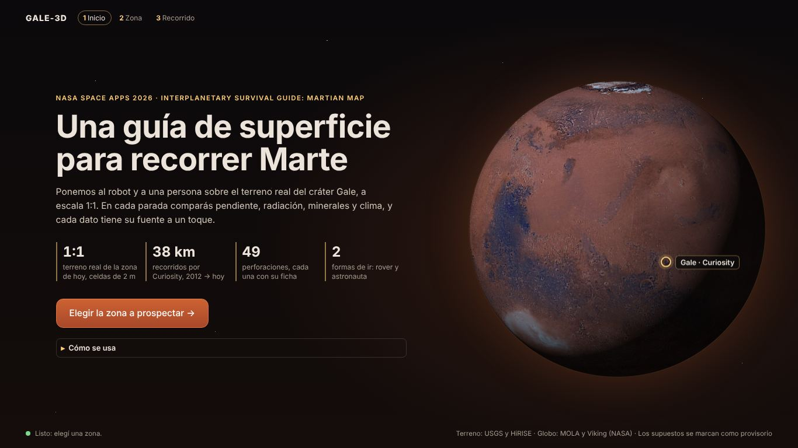
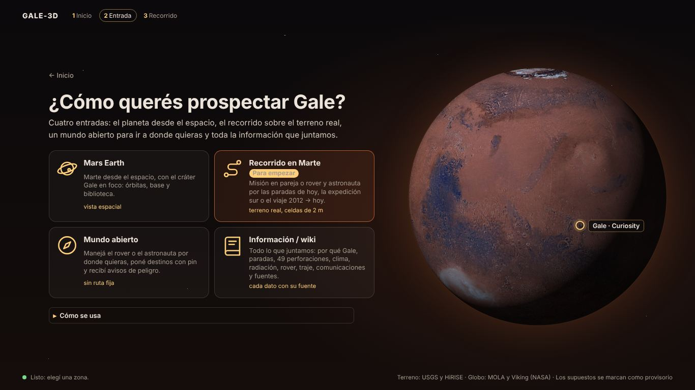
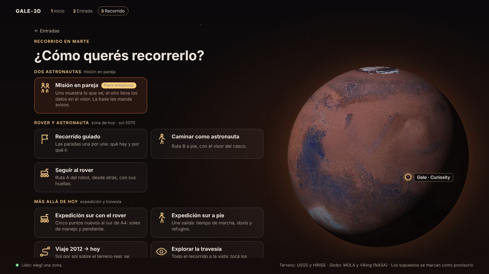
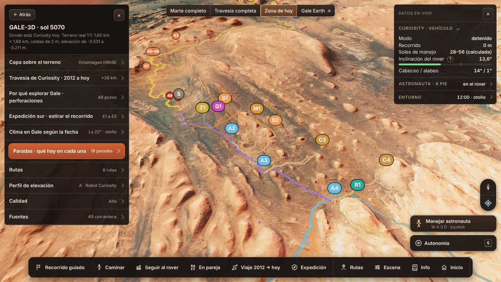
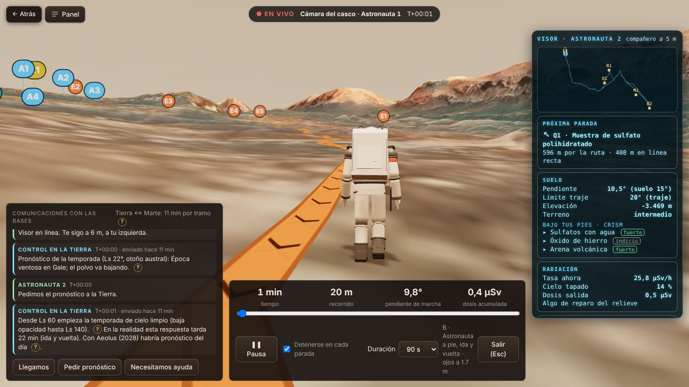
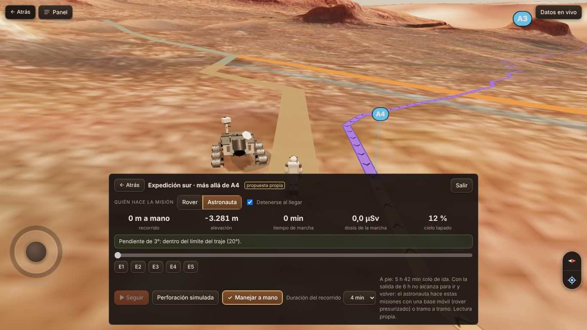
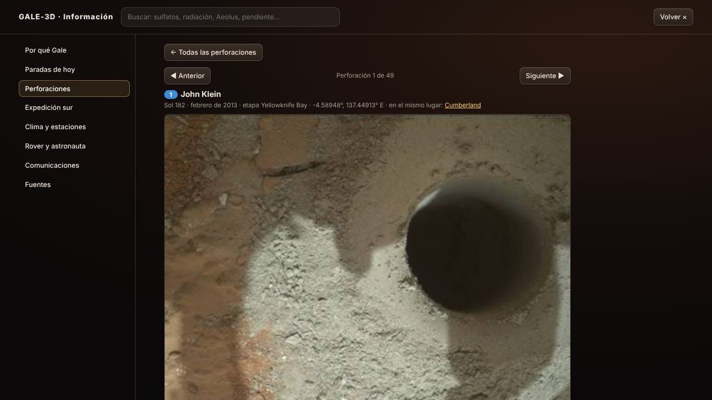
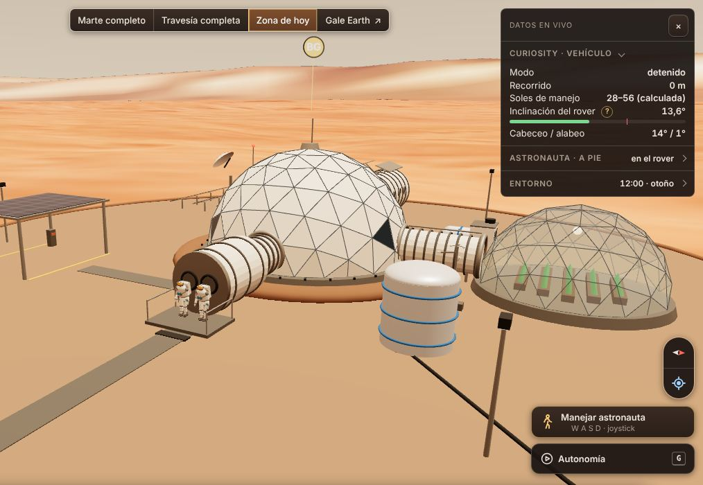
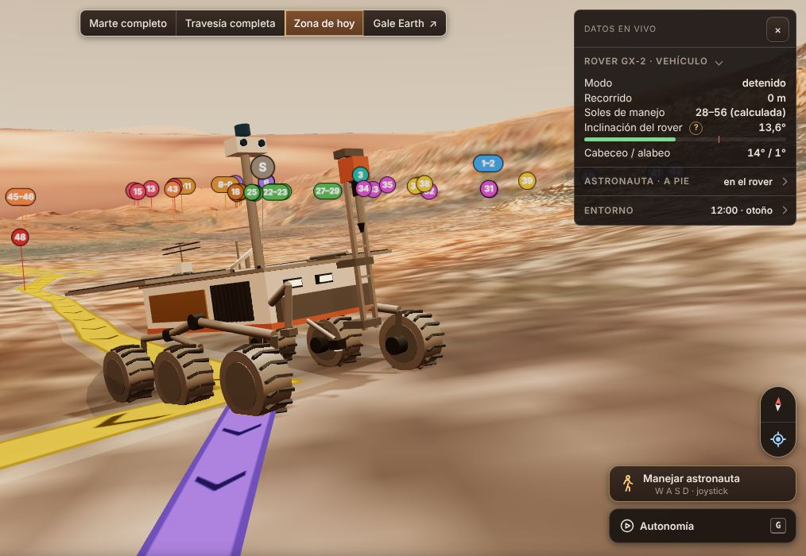

# Pantallas y botones de GALE-3D

Qué hace cada pantalla y cada botón, con su captura (en [capturas/](capturas/)). Si algo cambia, se actualiza este archivo.

## 1. Portada (tapa la escena mientras carga)

### Paso 1 · Inicio

- Título, una línea de qué es y cuatro números clave: 1:1, +38 km (NASA), 49 perforaciones y 2 formas de ir.
- **"Elegir la zona a prospectar →"** pasa al paso 2.
- "Cómo se usa" despliega los gestos y los controles.
- A la derecha, Marte girado hacia Gale, en una proyección del mosaico Viking con el marcador "Gale · Curiosity".
- Abajo, el estado de carga ("Listo: elegí una zona.") y los créditos de los datos.

### Paso 2 · Entrada

| Botón | Qué hace |
| --- | --- |
| **Mars Earth** | Marte se centra en Gale y abre Gale Earth, que arranca en el espacio y se acerca al cráter. Sin Gale Earth al lado, va a "Marte completo" dentro de la escena. |
| **Recorrido en Marte** (recomendado) | Paso 3 con los modos de recorrido. |
| **Mundo abierto** | Paso 3 con "¿Con qué querés moverte?". |
| **Información / wiki** | Abre la wiki enseguida, sin bajar a la escena. |

### Paso 3 · Recorrido

Los modos están agrupados:

| Grupo | Modos |
| --- | --- |
| Dos astronautas | **Misión en pareja** (recomendado) |
| Rover y astronauta | Recorrido guiado · Caminar como astronauta · Seguir al rover |
| Más allá de hoy | Expedición sur con el rover · Expedición sur a pie · Viaje 2012 → hoy · Explorar la travesía |

En **Mundo abierto** los modos son "Con el astronauta", "Con el rover" y "Cámara libre y destinos".

Al elegir, el globo se corre al centro con Gale en el medio, la portada se funde con el planeta 3D y la cámara baja hasta la zona. Recién ahí arranca el modo.

## 2. Escena (zona de hoy)

- **Arriba a la izquierda:** "← Atrás" vuelve al paso 3 de la entrada actual, y "Panel" abre el panel cuando está cerrado.
- **Arriba al centro:** vistas Marte completo · Travesía completa · Zona de hoy · Gale Earth ↗.
- **Panel izquierdo:** apartados plegables, todos cerrados al abrir, cada uno con un valor corto:
  - capa sobre el terreno;
  - travesía 2012 → hoy, con "Viajar del aterrizaje a hoy";
  - por qué explorar Gale y las perforaciones;
  - expedición sur;
  - clima según la fecha;
  - **Paradas** (en naranja);
  - rutas, perfil de elevación, calidad y fuentes.
- **Derecha:**
  - "Datos en vivo" en tres grupos plegables (rover, astronauta y entorno), que muestran un resumen cuando están cerrados;
  - brújula y centrar;
  - "Manejar astronauta", "Autonomía (G)", Visor/Ojos y "Volver a la base", según el modo.
- **Barra de abajo:**
  - modos: Recorrido guiado · Caminar · Seguir al rover · En pareja · Viaje · Expedición;
  - herramientas: Rutas · Escena · Info · Inicio.

  El modo activo queda en naranja; lo que se prende y apaga lleva `aria-pressed` y un ✓.
- **Rutas → "Poner destino":** se toca el terreno y se clava un pin. Calcula el camino del rover y el del astronauta (ida y vuelta) y muestra una tarjeta con:
  - distancia, soles de manejo, tiempo a pie y dosis;
  - avisos de pendiente y arena en el destino, a menos de 20 m y en el camino.

  Tiene "Ir (autonomía)", "A pie, en primera persona" y "Quitar". "Varias paradas" conserva el planificador anterior.

## 3. Misión en pareja (visualización principal 1)

- **Pantalla grande:** lo que ve el **Astronauta 1** (cámara del casco a 1,7 m). El Astronauta 2 camina 6 m adelante y a la izquierda, a la vista.
- **Arriba al centro:** "● EN VIVO · Cámara del casco · Astronauta 1 · T+hh:mm" (tiempo afuera).
- **Derecha · "VISOR · ASTRONAUTA 2":**
  - compañero a N m;
  - minimapa con la ruta, la base (B), las paradas y los dos astronautas (1 verde, 2 cian);
  - próxima parada;
  - suelo: pendiente, límite del traje, elevación, terreno y lo que hay bajo los pies según CRISM;
  - radiación: tasa, cielo tapado y dosis;
  - refugio: distancia, tiempo afuera, regreso a pie, margen y hora solar.
- **Abajo a la izquierda · "Comunicaciones con las bases":**
  - **Base · rover** (en Marte, al instante): salida autorizada, avisos a 45 m de cada parada con su motivo científico, llegada, pendiente sobre el límite a 30 m o menos, dosis cada 10 µSv, mitad y tres cuartos de la salida nominal, cierre.
  - **Control en la Tierra** (cian): pronóstico de la estación (Ls) con su fuente, marcado "enviado hace N min" según la demora real de la luz Tierra–Marte de ese día (`demoraLuz`, JPL).
  - **Astronauta 1 / 2** (verde): llegadas y reparo del relieve.
  - **Respuestas rápidas:**
    - "Llegamos": la base confirma la distancia;
    - "Pedir pronóstico": responde la Tierra, con la aclaración de que en la realidad tarda 2 × N min y la mención de Aeolus 2028;
    - "Necesitamos ayuda": el rover sale en camino, con el tiempo estimado a la velocidad del rover presurizado (supuesto).
- **Barra de primera persona** (a la derecha, abajo): avance, pausa, velocidad y salir.
- **Celular:** el visor y las comunicaciones quedan lado a lado, arriba de la barra.

## 4. Rover y astronauta (visualización principal 2)

- **Recorrido guiado:** vuela a cada parada (paradas de hoy más E1–E5) y abre su ficha, con Anterior y Siguiente.
- **Caminar:** ruta B a pie, en primera persona o desde atrás, con el visor del casco (V cambia el visor y B la vista).
- **Seguir al rover:** ruta A del robot, desde atrás, con huellas y polvo.
- **Expedición sur** (más allá de A4):

  

  - quién hace la misión (Rover o Astronauta) y "Detenerse al llegar";
  - datos: recorrido, elevación, tiempo o soles, dosis o desnivel, cielo tapado;
  - E1 a E5, ▶ Iniciar, Perforación simulada y **Manejar a mano** (W A S D o joystick, con aviso en vivo de pendiente y distancia a la base);
  - duración del recorrido: 1, 2, **4** (por defecto) u 8 min.
- **Viaje 2012 → hoy:** sol por sol por la travesía real. Se detiene en cada una de las 49 perforaciones.
- **Fichas de perforación:** foto MAHLI, qué se encontró (con fuente), minerales (CheMin), química (APXS), agua para una base (cálculo del equipo), datos crudos y novedades.

## 5. Mundo abierto

- **Con el astronauta:** baja del rover; W A S D o joystick. Los avisos cubren:
  - pendiente donde está y la que viene (cartel a 14 m o menos);
  - arena;
  - distancia y tiempo a la base;
  - margen del traje.
- **Con el rover:** W A S D, con la cámara detrás. Avisa la inclinación sobre el límite y la arena.
- **Cámara libre y destinos:** la cámara libre más "Rutas → Poner destino".

## 6. Información / wiki

- Pantalla completa con el mismo fondo que la portada: buscador arriba, secciones a la izquierda y contenido a la derecha.
- **Secciones:** Por qué Gale · Paradas de hoy · Perforaciones · Expedición sur · Clima y estaciones · Rover y astronauta · Comunicaciones · Base Gale · Rover GX-2 · Fuentes.
- **Buscador:** filtra las secciones, cuenta las coincidencias y las resalta (`<mark>`).
- **Perforaciones:** lista por campaña. Al tocar una, se ve la ficha completa dentro de la wiki, con "← Todas las perforaciones".
- Los botones que llevan a la escena ("Ver en 3D", "Caminar hasta acá", "Viajar hasta acá") cierran la wiki.
- Se abre desde la portada (entrada 4) o desde "Info" en la barra. Esc la cierra.

## 7. Mars Earth (Gale Earth, del compañero)

- **Globo de Marte en CesiumJS:** órbitas (MRO, Odyssey, Mars Express, TGO, Hope), Fobos y Deimos, base, Biblioteca de los 49 pozos, línea de tiempo y expedición de 20 km.
- **Desde la portada:** sin hash arranca en el espacio (`irA('marte')`) y a los 2,6 s vuela a la vista del cráter (`irA('gale')`).
- **Vuelta:** su botón "Misión Curiosity · 3D" vuelve a la escena (`#desde-gale-earth`), que baja desde lo alto hasta la zona de hoy.

## 8. Base Gale y rover GX-2 (próximas excavaciones)

- **Base Gale:** está en la **Zona 2** del análisis de sitios del equipo, en la llanura del aterrizaje (lon 137,37501°, lat −4,61681°), con el marcador "BG". Queda a 1,7 km del recorrido, a 4,3 km del aterrizaje de 2012 y a 12,4 km de Curiosity hoy. El lugar sale de `data/base/sitios_base.geojson` (zonas 1, 2 y 3; la 2 la eligió el equipo). Cada parte se toca y abre su ficha con fuente:
  - hábitat, túneles, laboratorio y esclusa con suitports;
  - invernadero, campo solar, reactor, antena y estación meteorológica;
  - planta de oxígeno, agua, garaje, luces y plataforma.
- **Código:** bloque `const BASE` (lee el lugar elegido del archivo y mide pendiente, cielo tapado y distancias sobre el terreno de la travesía) y `if (BASE) { … }` (modelos) en `plantilla.html`. Las partes van con `parte(clave, objeto)` y sus textos están en `PARTES_BASE`.

- **Rover GX-2:** en Escena → Rover se elige entre Curiosity y GX-2. Copia la posición, el rumbo y la inclinación del rover de la escena (`RN.seguir()` en el bucle), así que todo lo demás sigue igual.
- **Acciones:** Alas, Dron y Perforar 2 m. Tocarlo abre la ficha (`htmlGX`), que también está en la wiki.
- **Código:** `RN` en `plantilla.html`; las funciones son `rnActivar`, `rnPerforar`, `rnDron` y `rnBoton`.
