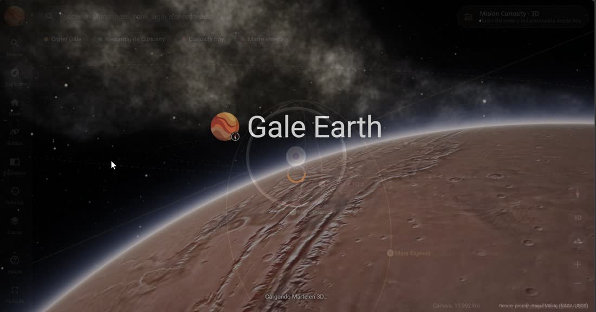
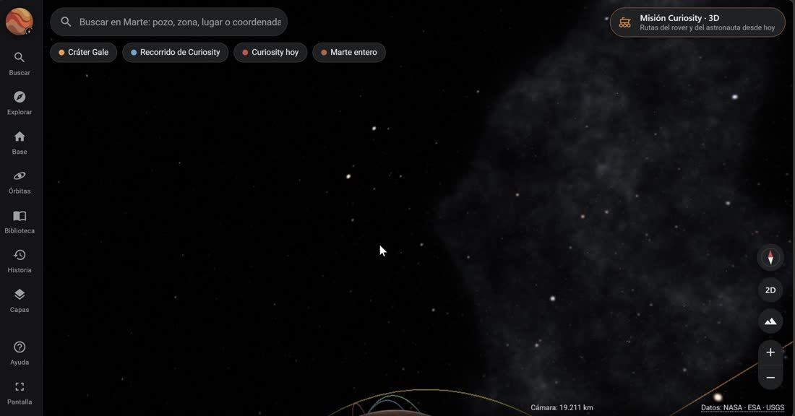
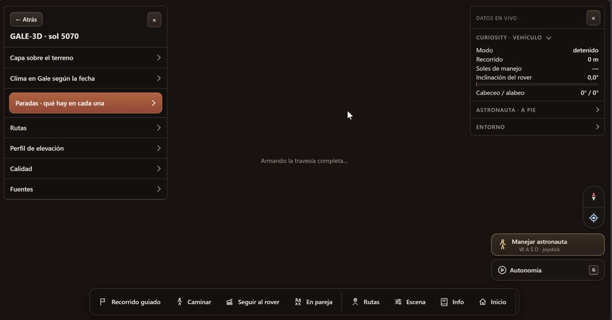
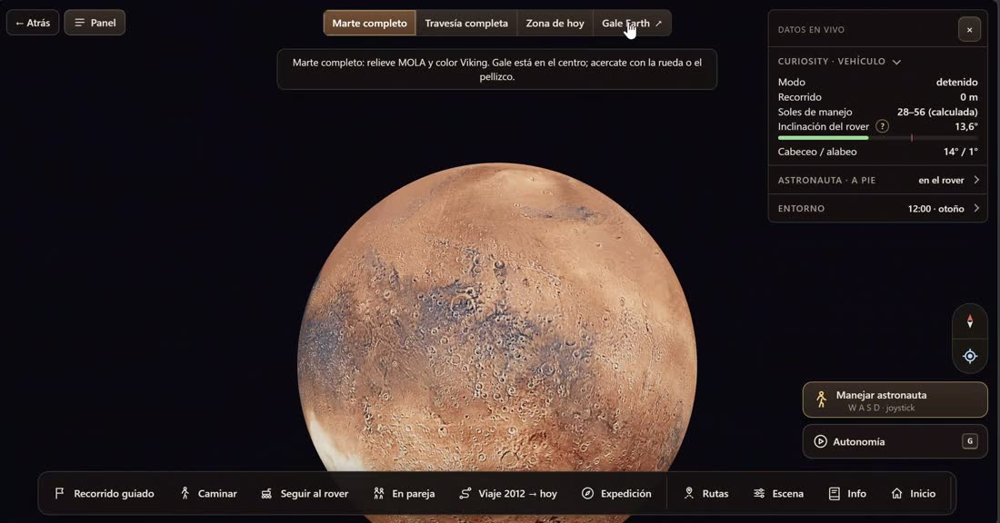
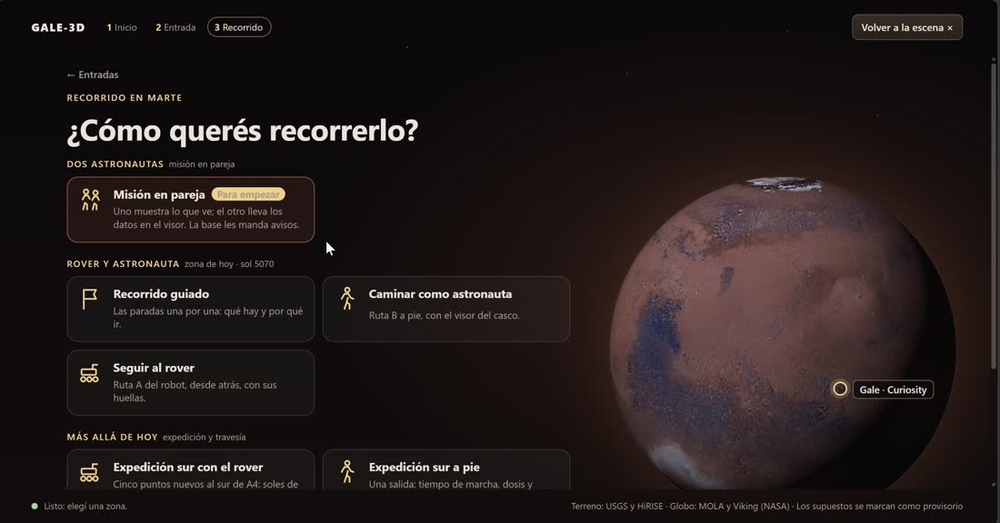
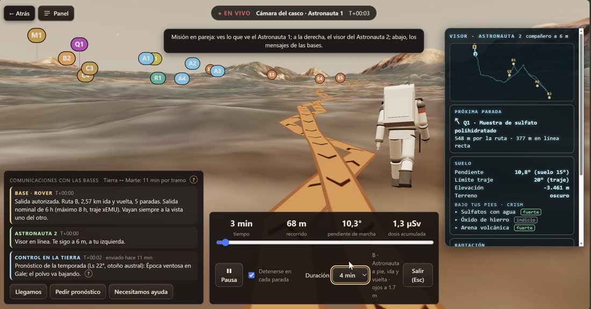

# QA y unificación: todo en Gale Earth

**Decisión del equipo (15/11, madrugada):** Gale Earth es **la única pantalla**. Todo lo que hoy vive en GALE-3D (`escena3d/`) pasa al mismo globo de Marte:
- la portada;
- las paradas, rutas, base y expedición de la zona de hoy;
- el rover y el astronauta;
- la misión en pareja y la wiki.

Nunca más se salta de un Marte a otro.

Este documento sale de la grabación de QA del 15/11 (`Grabación_2026-11-15_015611.mp4`, 2 min 24 s, sitio publicado en GitHub Pages). Tiene cinco partes:
1. lo que muestra el video, con su segundo;
2. cómo tiene que quedar;
3. las reglas de **transiciones, botones y movimientos** (lo más importante);
4. el paso a paso por fases;
5. el guion para volver a probar.

Las capturas están en `capturas/qa/`.

> **Para el equipo:** los mensajes para pegarle a Claude en cada fase, y qué revisar al terminar, están en [prompts-unificacion.md](prompts-unificacion.md).

> **Para Claude:** antes de tocar `gale-earth/`, leé `gale-earth/README.md`. Esa carpeta es del compañero: el código nuevo va en archivos nuevos (`gale-earth/portada.js`, `gale-earth/mision.js`) que `_ensamblar.py` suma, y cada cambio se anota en `docs/notas.md`. No se edita `plantilla.html` ni `index.html` a mano, en ninguna de las dos carpetas.

---

## 1. Lo que muestra el video

La grabación es del sitio publicado (`main`). La Base Gale y el rover GX-2 todavía no están ahí: están en la rama `david/union-gale-earth`.

| # | Segundo | Qué pasa | Por qué pasa (código) | Qué queremos |
| --- | --- | --- | --- | --- |
| H1 | 3–8 | Tocar **Mars Earth**: Marte se centra y **corta a negro**. Gale Earth arranca de cero, a 32.000 km, con otra pantalla de carga. | Son dos páginas: `irMarsEarth()` hace `location.href = '../gale-earth/index.html'` a los 1,25 s. Gale Earth carga Cesium y hace `irA('marte', 0)`. | Sin cambio de página. El Marte de la portada **es** el globo de Gale Earth y se corre al centro (T3). |
| H2 | 9–11 y 50 | En el vuelo del espacio al cráter, la cámara **mira al espacio vacío**: solo estrellas. | `irA('gale', 3)` es un `flyTo` de 32.000 km a 70 km con inclinación final −0,55 y sin `pitchAdjustHeight`: Cesium interpola el ángulo y Marte sale de cuadro. | Marte siempre en cuadro: vuelo en dos tramos, o `pitchAdjustHeight` (3.1). |
| H3 | 12, 42, 52, 134 | Al llegar, el relieve se ve **borroso** unos segundos. | La vista se muestra antes de que carguen las teselas de detalle (en GALE-3D, el fondo MOLA de baja resolución). | No mostrar la llegada hasta que el terreno esté cargado, con un tope (3.1). |
| H4 | 14–18, 56 | Los pines de pozos, zonas y sitios **no muestran que se pueden tocar**: no hay mano ni realce. | En Gale Earth, `MOUSE_MOVE` solo actualiza las coordenadas. Ningún pin cambia al pasar por arriba. | Estados de pin: hover, seleccionado y visitado (3.3). |
| H5 | 20–26 | **Misión Curiosity · 3D**: fundido a negro y, encima de un fondo negro, aparecen los paneles y la barra de GALE-3D ("Cargando ortoimagen…", "Armando la travesía completa…"). Es otro Marte, con otra interfaz. | Es un enlace a `../escena3d/index.html#desde-gale-earth`. La escena muestra su interfaz antes de tener terreno. | "Misión Curiosity" es un **modo dentro del mismo globo**. Ningún panel aparece antes de que esté lo que muestra. |
| H6 | 40–44 | En GALE-3D, **Marte completo** muestra el globo propio de la escena (MOLA + Viking, borroso al pasar) y no el de Gale Earth. "Datos en vivo" queda encima del espacio. | `vPlaneta`: globo propio de three.js. | Un solo Marte entero: el de Gale Earth (chip "Marte entero"). |
| H7 | 44–48 | **Gale Earth ↗** recarga Gale Earth entera: pantalla de carga y vuelta a los 32.000 km, aunque el usuario venía de ahí. | `vMarteGE` hace `location.href = '../gale-earth/index.html#curiosity'`. | Desaparece: ya estás en Gale Earth. |
| H8 | 60–65 | Al volver a la escena, se ven paneles vacíos ("Cargando three.js…") y después la portada en el **paso 3 (Recorrido)**. | `#desde-gale-earth` y `__portada.atras()`, que siempre abre el paso 3 (`zona(zonaAct)`). | **Volver o Atrás lleva al paso 2 (Entrada).** |
| H9 | 72–84 | Al tocar o arrastrar sobre la portada, el título queda **seleccionado** (resaltado azul). | Falta `user-select: none` en la portada. | Textos de la portada no seleccionables; los datos y las fichas sí. |
| H10 | 92–98 | **Misión en pareja**: la entrada (centrar Marte → bajar → vista) anda bien, pero el astronauta **arranca a caminar solo**. | `entrarPareja()` pone `fp.jugando = true`. Lo mismo `caminar()` y `seguirRover()`. | Todo modo **arranca en pausa**, con la base mandando el primer mensaje y un botón "▶ Salir" (3.4). |
| H11 | 98–104 | Duración por defecto de **90 s**: 81 m en 4 s de video, demasiado rápido para leer. | `#f-vel` tiene `90 s` como `selected` (opciones 30 s, 90 s y 4 min). La expedición sí arranca en 4 min. | **4 min por defecto** para el rover y el astronauta, en todos los modos; opciones 1, 2, 4 y 8 min (3.4). |
| H12 | 116 | Caminar: al arrancar aparece "Llegaste a S · Salida". | En `main` todavía cuenta la salida como parada. En la rama ya se saltea (S y paradas a menos de 15 m). | Verificar en la publicación después de fusionar. |
| H13 | 122–126, 140 | **Inicio** desde un modo abre la portada en el paso 3, no en el 2. | Igual que H8. | Paso 2 (Entrada) siempre. Solo "← Inicio", dentro de la portada, vuelve al paso 1. |
| H14 | 130–138 | **Expedición sur a pie**: llega bien. En el camino se ve el relieve borroso (H3) y la barra aparece antes que el rover y el astronauta. | Igual que H3 y H5. | Igual que H3 y H5. |
| H15 | todo | **Dos Martes distintos**, con distinta textura, color, controles y paneles. Gale Earth tiene riel a la izquierda y chips arriba; GALE-3D tiene panel izquierdo, barra abajo y "Datos en vivo" a la derecha. | Son dos productos que se unieron por enlaces. | Un solo lenguaje: el de Gale Earth, con los componentes de GALE-3D adaptados a su estilo (sección 2). |

| H1 · corte a Gale Earth (7 s) | H2 · vuelo sin Marte (10 s) | H5 · paneles sin escena (24 s) |
| --- | --- | --- |
|  |  |  |
| **H6 · Marte completo propio (44 s)** | **H8 · vuelta al paso 3 (65 s)** | **H11 · pareja a 90 s (101 s)** |
|  |  |  |

Más capturas: `h03_relieve_borroso.jpg`, `h09_texto_seleccionado.jpg` y `h12_llegaste_a_s.jpg`.

### ¿Qué diferencia hay hoy entre "Curiosity hoy" y "Misión Curiosity · 3D"?
- **Curiosity hoy** (chip de Gale Earth) solo **mueve la cámara** a donde está Curiosity, a 1,5 km. Muestra lo que Gale Earth ya tiene: el recorrido por zonas y las 49 perforaciones.
- **Misión Curiosity · 3D** **abre otra página** (GALE-3D) con todo lo que armamos para la zona de hoy:
  - 19 paradas con su motivo científico;
  - rutas A, B y C;
  - Base Gale y expedición sur E1–E5;
  - rover (Curiosity o GX-2) y astronauta;
  - misión en pareja, visor y comunicaciones;
  - perforación simulada, mundo abierto y wiki.
- **Después de unificar,** "Curiosity hoy" muestra todo eso en el mismo globo. "Misión Curiosity" pasa a ser el modo que recorre las rutas nuevas con el rover y el astronauta.

---

## 2. Cómo tiene que quedar: una sola pantalla

```
Gale Earth  (un solo globo Cesium, siempre detrás; una sola URL)
├─ Portada  (capa encima del globo; el Marte de la derecha ES el globo)
│   ├─ 1 Inicio
│   ├─ 2 Entrada:  Mars Earth · Recorrido en Marte · Mundo abierto · Información / wiki
│   └─ 3 Recorrido: Misión en pareja · Recorrido guiado · Caminar · Seguir al rover · Expedición sur · Viaje 2012 → hoy
└─ Globo
    ├─ Chips de vista (arriba):  Cráter Gale · Recorrido de Curiosity · Curiosity hoy · Marte entero
    ├─ Riel (izquierda):  Buscar · Explorar · Base · Órbitas · Biblioteca · Historia · Capas · Ayuda
    └─ Barra de modos (abajo; solo con "Curiosity hoy"):
         Vista del astronauta (en pareja) · Misión Curiosity (rutas nuevas) · Mundo abierto
```

### Qué muestra cada vista

| Vista | Qué se ve | Qué se puede hacer |
| --- | --- | --- |
| **Marte entero** | El planeta, órbitas y lunas (como hoy en Gale Earth). | Buscar lugares, órbitas, línea de tiempo. |
| **Cráter Gale** | Borde del cráter (154 km), zonas, sitios candidatos para la base. | Ficha de Gale, comparar sitios. |
| **Recorrido de Curiosity** | La travesía 2012 → hoy y las **49 perforaciones** (ya está en Gale Earth). | Fichas de pozos (Biblioteca) y **Viaje 2012 → hoy** (animación sobre la travesía). |
| **Curiosity hoy** | La **zona de hoy completa**: paradas (pines con su letra y color), rutas A, B y C, **Base Gale** en 3D, expedición E1–E5, y el rover y el astronauta parados en la salida. | Tocar cualquier pin → ficha con fuente. Abajo, la barra de modos. |
| **Vista del astronauta** | La misión en pareja: cámara del casco del Astronauta 1, visor del Astronauta 2, comunicaciones con las bases. | Recorrido guiado por el compañero o manejado a mano. |
| **Misión Curiosity** | Las **rutas nuevas** que proponemos con los datos, recorridas por el rover (Curiosity o GX-2) y el astronauta. | Elegir ruta, duración (4 min por defecto), detenerse en cada parada, perforar. |
| **Mundo abierto** | Sin ruta fija. | Manejar al rover o al astronauta, poner un destino con pin, recibir avisos de peligro. |

### Qué desaparece
- El enlace **Misión Curiosity · 3D** a otra página: pasa a ser un modo del mismo globo.
- En GALE-3D, **Marte completo** y **Gale Earth ↗**.
- El globo propio de three.js (`GLOBO`, la imagen MOLA + Viking de la escena).
- La segunda pantalla de carga. Queda una sola, con el estilo de la portada (3.2, T1).

### Qué se mantiene igual
- Cada dato con su fuente a un toque (los "?").
- Medido, cálculo propio y supuesto, siempre marcados.
- La paleta y la tipografía de `estilo-visual.md`.
- La misma lógica de la escena: rutas, pendiente, radiación, CRISM, demora de la luz y avisos. Se porta, no se reinventa.

---

## 3. Transiciones, botones y movimientos

### 3.1 Reglas generales

**Nunca un corte a negro.** Todo cambio es un fundido de la interfaz más un vuelo de cámara. Si algo tiene que cargar, se ve la pantalla de carga con el estilo de la portada, nunca paneles vacíos.

| Qué | Duración | Curva |
| --- | --- | --- |
| Hover (botón, tarjeta, pin) | 120 ms | `cubic-bezier(.2,.7,.2,1)` |
| Presionar | 80 ms (`scale(.98)`) | lineal |
| Cajón, paneles, HUD (entrar y salir) | 240 ms (`translateY(12px)` → 0 y opacidad) | `cubic-bezier(.2,.7,.2,1)` |
| Portada (entrar y salir) | 450 ms | `cubic-bezier(.4,0,.2,1)` |
| Marte de la derecha al centro (`frustum.xOffset`) | 900 ms | `cubic-bezier(.4,0,.2,1)` |
| Vuelo corto (dentro de Gale) | 1,6–2,2 s | `Cesium.EasingFunction.CUBIC_IN_OUT` |
| Vuelo largo (espacio ↔ cráter) | 3,0–3,8 s en dos tramos | `QUADRATIC_IN_OUT` |
| Aparición escalonada (chips, botones de una barra) | 40 ms entre cada uno | `cubic-bezier(.2,.7,.2,1)` |

- **Durante un vuelo largo**, los chips, el riel y la barra de modos bajan a 30 % de opacidad. Vuelven al llegar. Tocar o arrastrar cancela el vuelo (Cesium lo hace solo) y la interfaz vuelve enseguida.
- **Marte siempre en cuadro.**
  - Si la cámara está a más de 2.000 km, vuela primero sobre Gale **mirando hacia abajo** (inclinación −90°, unos 1.500 km de altura) y después baja inclinada.
  - Otra opción es `flyTo({ …, pitchAdjustHeight: 1000000 })`, que inclina la cámara hacia abajo mientras está alta y mantiene el planeta en pantalla.
- **Terreno cargado antes de mostrar.**
  - Al final de un vuelo, la cámara espera a que `viewer.scene.globe.tilesLoaded` (globo propio) o `tileset.tilesLoaded` (Cesium Mars) sea verdadero, con un tope de 2,5 s.
  - Mientras tanto queda unos metros más alta, y baja el último tramo cuando cargó.
  - Si pasa el tope, un aviso chico: "Cargando relieve…". Nunca una pantalla borrosa sin explicación.
- **`prefers-reduced-motion`:** vuelos de 0,6 s, sin escalonado ni rotación del globo.

### 3.2 Tabla de transiciones

| # | Desde → hacia | Qué se mueve | Duración | Terminado cuando |
| --- | --- | --- | --- | --- |
| T1 | Abrir la página → portada (paso 1) | Una sola pantalla de carga con el estilo de la portada (fondo, tipografía, "Cargando Marte en 3D…"). Al cargar el globo, Marte aparece a la derecha con un fundido de 600 ms y gira lento (0,5° por segundo). | 600 ms | No se ve el logo de carga de Gale Earth y después la portada: es una sola cosa. |
| T2 | Paso 1 → 2 → 3 (y "←" para atrás) | El texto de la portada se va a la izquierda y entra el nuevo (`translateX(16px)` y opacidad). El globo no se mueve: solo gira hacia Gale y se ve el pin "Gale · Curiosity". | 280 ms | El globo no salta ni se recarga. |
| T3 | Paso 2 → **Mars Earth** | La portada se desvanece (450 ms). Marte se corre al centro (`frustum.xOffset` de −0,35 a 0, 900 ms). Vuelo en dos tramos hasta el cráter (3.1). Al llegar, entran los chips y el riel (escalonado). | ~4,5 s | Ningún cuadro negro. Marte siempre visible. Llegada nítida. |
| T4 | Paso 3 → un modo (pareja, guiado, caminar, seguir al rover, expedición) | Igual que T3, más un tercer tramo hasta la salida de la ruta. La barra del modo entra desde abajo. El modo queda **en pausa** con la tarjeta "Listos para salir" (3.4). | ~5,5 s | Nada se mueve solo. El HUD aparece después de llegar. |
| T5 | Chip → chip | Vuelo de 1,8 s (dentro de Gale) o 3 s (a Marte entero). Las capas de la vista anterior se apagan con un fundido de 300 ms y las de la nueva se encienden al llegar. El chip activo queda pintado. | 1,8–3 s | Un solo chip activo. Las capas no "saltan". |
| T6 | Curiosity hoy → Misión Curiosity o Vista del astronauta | La cámara baja de ~1.500 m a la vista de seguimiento: detrás del rover, o a 1,7 m en el casco. El HUD (visor y comunicaciones) entra cuando la cámara llega. | 2 s | Igual que T4. |
| T7 | Salir de un modo (Salir o Esc) | El HUD sale (240 ms). La cámara sube a la vista de Curiosity hoy (2 s). Vuelve la barra de modos. | 2,3 s | El rover y el astronauta quedan donde estaban; la cámara no "teletransporta". |
| T8 | **Atrás / Inicio** desde cualquier lugar | La portada vuelve con un fundido de 450 ms en el **paso 2 (Entrada)**. Marte vuelve a la derecha (`xOffset` de 0 a −0,35) mientras la cámara sube al espacio (3 s). | 3 s | Siempre el paso 2. Solo "← Inicio" dentro de la portada lleva al 1. |
| T9 | Tocar un pin → ficha (y cerrar) | El cajón entra desde la izquierda (240 ms). La cámara se acerca al pin (1,6 s) solo si está fuera de cuadro o muy lejos. | 0,24–1,6 s | La ficha no tapa el pin tocado. Cerrar no mueve la cámara. |
| T10 | Wiki (abrir y cerrar) | Una capa con fundido de 300 ms encima del globo, que sigue detrás con desenfoque. Cerrar devuelve exactamente a donde estaba. | 300 ms | Nunca recarga ni mueve la cámara. |

### 3.3 Estados de botones y pines

| Elemento | Hover (mouse) | Foco (teclado) | Presionado | Activo / elegido | Deshabilitado | Cargando |
| --- | --- | --- | --- | --- | --- | --- |
| Tarjeta de la portada | Borde y título en acento, sube 2 px, ícono en acento | Contorno de 2 px en acento | `scale(.98)` | Pulso suave (1 vez) antes de T3 o T4 | Opacidad .5 y `title` con el motivo | "Preparando…" en la tarjeta |
| Chip de vista | Fondo un poco más claro | Contorno de 2 px | `scale(.98)` | Fondo con su color al 25 % y punto de color lleno (`aria-pressed`) | — | Punto que late mientras vuela |
| Riel (izquierda) | Fondo `#ffffff10` | Contorno de 2 px | — | Pestaña abierta con fondo y texto en acento | — | — |
| Barra de modos y botones del HUD (Pausa, Salir, Alas, Dron…) | Fondo un poco más claro | Contorno de 2 px | `scale(.98)` | Relleno acento y ✓ (como `aria-pressed` hoy en GALE-3D) | Opacidad .5 y `title` con el motivo | Rueda chica a la izquierda del texto |
| **Pin** (pozo, parada, sitio, base, expedición) | **Cursor de mano**, escala de 1 a 1,18 (120 ms), etiqueta visible y una línea: "Tocá para ver la ficha" | — | — | Anillo blanco mientras su ficha está abierta | — | — |
| Pin visitado | — | — | — | Borde atenuado (ya se abrió su ficha) | — | — |

**Cómo se hace el hover de los pines en Cesium:**
- un solo `MOUSE_MOVE`, limitado a un `scene.pick` por cuadro con `requestAnimationFrame`;
- si toca una entidad con `properties.tipo`, `viewer.canvas.style.cursor = 'pointer'`, sube `billboard.scale` y muestra la etiqueta;
- si no toca nada, vuelve todo a como estaba.

En pantallas táctiles no hay hover: un toque abre la ficha directamente.

**Regla:** nunca dos botones que hagan lo mismo con distinto nombre (hoy pasa con "Curiosity hoy" y "Misión Curiosity · 3D", y con "Marte completo" y "Gale Earth ↗").

### 3.4 Movimientos (rover, astronauta y cámara)
- **Duración por defecto: 4 min** para todo recorrido, con el rover o el astronauta: recorrido guiado, caminar, seguir al rover, pareja y expedición.
  - Opciones: 1, 2, 4 y 8 min.
  - La elección se recuerda en el navegador (con `try/catch`).
- **Arranque en pausa.** Al entrar a un modo, el rover o el astronauta queda en la salida y aparece la tarjeta **"Listos para salir"**, con:
  - el primer mensaje de la base (ruta, largo, paradas, duración nominal de la salida);
  - "▶ Salir" (principal) y "Cambiar ruta".
  - Nada se mueve hasta tocar "Salir".
- **Paradas.** "Detenerse en cada parada" viene marcado: al llegar, tarjeta con "Ver la parada", "Perforación simulada" y "Seguir ▶". Nunca cuenta la salida (S) como parada.
- **Cambiar la duración en marcha** no hace saltar al personaje: sigue en el mismo punto con el ritmo nuevo.
- **Cámara de seguimiento:**
  - rover: 9 m detrás y 4 m arriba;
  - astronauta: 6 m detrás y 2,2 m arriba;
  - siempre suavizada (que siga con un poco de retraso, sin quedar rígida).
  - En primera persona va a 1,7 m. Al girar en una curva, la cámara rota de a poco: no más de 60° por segundo.
- **Misión en pareja:** el Astronauta 2 va 6 m adelante y 1,1 m a la izquierda (como hoy). Los mensajes de la base salen enseguida; los de la Tierra, con la demora real de la luz.
- **Velocidad real de referencia** (para los textos, no para la animación): Curiosity hace 30–60 m por sol de manejo; el astronauta, 2,5 km/h en llano (`data/parametros.json`).

---

## 4. Paso a paso de la unificación

Cada fase tiene **qué**, **dónde**, **cómo** y **terminado cuando**. El tamaño es una estimación (S: hasta 2 h; M: 2 a 5 h; L: más de 5 h).

**Quién hace qué:** `gale-earth/` es del compañero. Para no pisarse, el código nuevo va en archivos nuevos que `_ensamblar.py` suma (`portada.js`, `mision.js`). En los archivos que ya existen solo se agregan enganches cortos, y todo se anota en `docs/notas.md`.

### Fase 0 · Arreglos rápidos sobre lo que ya está publicado (S–M) — para la demo
Sirve aunque la unificación no llegue: corrige lo que más se nota en el video.

| # | Qué | Dónde | Terminado cuando |
| --- | --- | --- | --- |
| 0.1 | Todos los recorridos arrancan **en pausa** y en **4 min** (H10, H11) | `escena3d/plantilla.html`: en `entrarPareja()`, `caminar()`, `seguirRover()` y los botones de la portada que llaman a `entrarFP`, cambiar `fp.jugando = true` por la tarjeta "Listos para salir". En `#f-vel`: opciones 60, 120, 240 (`selected`) y 480. | Pareja, caminar y seguir quedan quietos en la salida con "▶ Salir", y la barra dice 4 min. |
| 0.2 | **Atrás e Inicio → paso 2** (H8, H13) | `__portada.atras()`: `ir(2)` en lugar de `zona(zonaAct)`. Al volver de Gale Earth no se abre la portada. | Desde cualquier modo, Inicio o Atrás muestra "¿Cómo querés prospectar Gale?". |
| 0.3 | **Ningún panel antes de tiempo** (H5, H8) | Clase `body.cargando` que oculta `#panel`, `#ctrl`, `#derecha` y `#flot` hasta `__portada.listo`. Con `#desde-gale-earth`, la cortina `#transicion` queda hasta que haya terreno. | No se ve "Cargando three.js…" con paneles vacíos. |
| 0.4 | Portada **no seleccionable** (H9) | CSS: `.portada { user-select: none }`, salvo `input` y `details`. | Arrastrar sobre el título no lo resalta. |
| 0.5 | Gale Earth: **Marte en cuadro** en el vuelo (H2) | `gale-earth/_cuerpo.html`, `irA('gale')` y `irA('hoy')`: vuelo en dos tramos, o `pitchAdjustHeight`. | En ningún cuadro del vuelo se ve solo el espacio. |
| 0.6 | Gale Earth: **hover en los pines** (H4) | Un `MOUSE_MOVE` nuevo (3.3) en `interfaz.js`. | Mano, agrandado y etiqueta sobre pozos, sitios y zonas. |
| 0.7 | **Transición Mars Earth** sin corte (H1) | `irMarsEarth()` pasa `#desde-portada`. Gale Earth, con ese hash, muestra la pantalla de carga con el estilo de la portada (fondo y Marte a la derecha) y arranca con el mismo encuadre. | El cambio de página se percibe como un fundido, no un corte a negro. |
| 0.8 | **Un solo botón por cosa** (H6, H7) | En GALE-3D, "Marte completo" hace lo mismo que "Gale Earth ↗" y queda uno solo: "Mars Earth". | No hay dos Martes enteros. |
| 0.9 | Fusionar la rama y verificar H12 en la publicación | PR de `david/union-gale-earth` (Base Gale y GX-2) a `main`. | En el sitio publicado, Caminar no muestra "Llegaste a S". |

### Fase 1 · Los datos de la misión para Gale Earth (M)
- **Qué:** un archivo `gale-earth/datos/mision.json` con todo lo de la zona de hoy, en longitud y latitud:
  - **paradas:** id, letra, color, nombre, motivo científico, quién va, suelo, CRISM y radiación;
  - **rutas A, B y C y expedición E1–E5:** línea más una muestra cada 5 m con distancia, elevación, pendiente, cielo tapado y arena;
  - **Base Gale:** en la **Zona 2** de `data/base/sitios_base.geojson` (la que tiene `elegida: true`), con su rumbo (la esclusa mira al punto más cercano del recorrido) y sus partes, con textos y fuentes;
  - **mensajes de la base** y **parámetros:** salida a pie, velocidades y dosis;
  - las claves de `FUENTES_URL` que usen.
- **Dónde:** una opción nueva `--exportar-mision` en `escena3d/armar.py`, que sale de `data/rutas/*.geojson`, `data/curiosity/*` y la grilla de 2 m.
  - El lugar de la base no se calcula: se lee de `data/base/sitios_base.geojson`, el análisis de sitios del equipo (zonas 1, 2 y 3 en la llanura del aterrizaje). La base va en la Zona 2.
  - Para pasar a longitud y latitud se usa la misma conversión que `mundoALonLat`.
- **Cómo:** con las muestras por tramo, el visor y los avisos ya no necesitan la grilla de 2 m en el navegador.
- **Terminado cuando:**
  - el JSON pesa menos de 2 MB;
  - `gale-earth/armar.py` lo mete en la página y avisa si falta;
  - la base cae en la Zona 2, a menos de 2 m de donde está en GALE-3D.

### Fase 2 · La portada dentro de Gale Earth (M)
- **Qué:** la portada (tres pasos, cuatro entradas, modos agrupados) pasa a ser una capa `#portada` encima del globo de Cesium. El Marte de la derecha es el globo de Gale Earth, corrido con `viewer.camera.frustum.xOffset = -0.35`.
- **Dónde:** `gale-earth/portada.js` (nuevo) más el HTML y el CSS en `cabecera.html`, copiados de la portada de `escena3d/plantilla.html` y adaptados a las variables de color de Gale Earth.
- **Cómo:**
  - la pantalla de carga (`#cargando`) se funde con la portada: mismo fondo, y "Cargando Marte en 3D…" en el lugar del estado;
  - las transiciones son T1, T2, T3 y T8;
  - las entradas que todavía viven en GALE-3D (hasta las fases 5 a 7) abren la escena con T3 y el estilo de la portada.
- **Terminado cuando:** abrir la URL, elegir Mars Earth y volver con Atrás no cambia de página y no tiene cortes.

### Fase 3 · "Curiosity hoy" completo (M)
- **Qué:** con el chip "Curiosity hoy" se ven, en Gale Earth:
  - las paradas, como pines con su letra y color;
  - las rutas A, B y C, como líneas pegadas al suelo con flechas;
  - la expedición E1–E5;
  - la Base Gale, como pin hasta la fase 4.
- **Dónde:** `gale-earth/mision.js` (nuevo).
  - Rutas: `polyline` con `clampToGround: true` y `PolylineArrowMaterialProperty` o una cinta propia.
  - Pines: `billboard` con `heightReference: CLAMP` (ya definido en `_cuerpo.html`) y `properties.tipo` de `'parada'`, `'expe'` o `'basegale'`.
  - Clics: se suman al `LEFT_CLICK` existente.
- **Fichas:** se portan `llegadaParada` y la ficha de parada, `htmlBase`, `fichaExpe` y `htmlGX` al cajón de Gale Earth (`#cajon`), con los mismos textos y "?".
- **Terminado cuando:** todo lo de la zona de hoy se ve y se toca en Gale Earth, con fuente, y los pines tienen los estados de 3.3.

### Fase 4 · Modelos 3D en el globo (M–L)
- **Qué:** Curiosity, el GX-2, el astronauta y la Base Gale como modelos `.glb` sobre el terreno de 1 m de Gale Earth.
- **Dónde:**
  - Exportación: una página `escena3d/exportar_modelos.html` que arma cada modelo con el mismo código de la escena (`malla`, `MAT`, `RN`, la base) y lo baja con `GLTFExporter` de three.js. Se corre una vez con Playwright y guarda `gale-earth/capas/modelos/*.glb`.
  - En Cesium: `viewer.entities.add({ model: { uri, minimumPixelSize: 48, heightReference: CLAMP }, orientation })`.
- **Animaciones** sin rehacer los modelos:
  - se nombran las piezas al exportar (`rueda_0` a `rueda_5`, `pierna_i`, `pierna_d`, `brazo_i`, `brazo_d`, `sarta`, `carro`, `ala_i`, `ala_d`, `rotor_0`, `rotor_1`, `lidar`);
  - cada cuadro se mueven con `model.nodeTransformations`.
- **Terminado cuando:**
  - los modelos apoyan en el suelo (menos de 0,3 m de diferencia);
  - la base mira hacia Curiosity, como en GALE-3D;
  - Gale Earth sigue a más de 30 cuadros por segundo en una PC común.

### Fase 5 · Misión Curiosity: las rutas nuevas con el rover y el astronauta (L)
- **Qué:** el modo que hoy es "Recorrido guiado", "Seguir al rover", "Caminar" y "Expedición", ahora dentro de Gale Earth.
- **Dónde:** `gale-earth/mision.js`. Se porta la lógica de `ubicarFP`, `paradasDeRuta`, `llegadaParada` y `tickExpe` de la escena.
- **Cómo:**
  - **posición:** `SampledPositionProperty` a lo largo de la ruta, con la distancia de `mision.json`;
  - **velocidad:** el reloj de Cesium (`viewer.clock.multiplier = largo de la ruta / segundos elegidos`), así 4 min son 4 min;
  - **orientación:** `VelocityOrientationProperty`;
  - **paradas:** pausa con `viewer.clock.shouldAnimate = false` y la tarjeta;
  - **cámara de seguimiento** (3.4): `camera.lookAt` cada cuadro, con suavizado;
  - **barra de abajo:** se porta la de GALE-3D (`#fp`).
  - **GX-2:** Escena → Rover (Curiosity o GX-2), con Alas, Dron y Perforar 2 m animados por nodos (fase 4).
- **Terminado cuando:** se cumplen T4, T6 y T7 y todo 3.4.

### Fase 6 · Vista del astronauta: la misión en pareja (L)
- **Qué:** la misión en pareja dentro de Gale Earth:
  - **cámara del casco** del Astronauta 1, con `camera.setView` cada cuadro, a 1,7 m y con el rumbo de la ruta;
  - **visor** del Astronauta 2 a la derecha;
  - **comunicaciones** abajo a la izquierda, con la Base Gale, el compañero y la Tierra;
  - **minimapa**.
- **Dónde:** se portan `entrarPareja`, `tickPareja`, `actualizarVisor`, `demoraLuz` y los mensajes. Los datos del visor salen de las muestras de `mision.json` (fase 1).
- **Cómo:** la base manda el primer mensaje en "Listos para salir" (3.4). Los mensajes nuevos de la base, cuando se arme ese guion, se suman a la misma lista.
- **Terminado cuando:** la pareja hace lo mismo que en GALE-3D, con los mismos números, dentro del mismo globo.

### Fase 7 · Mundo abierto y destino con pin (M)
- **Qué:** manejar al rover o al astronauta con W A S D o joystick, y poner un destino con aviso de zonas de peligro.
- **Cómo:**
  - **altura** con `viewer.scene.sampleHeight` (Cesium Mars) o `globe.getHeight` (globo propio);
  - **pendiente y arena** de la zona de hoy: con una imagen de grilla georreferenciada, como hace la escena con `PEND` y `CLASE`;
  - **fuera de la zona:** la pendiente se calcula con alturas del terreno, con la marca "cálculo propio".
- **Terminado cuando:** los avisos (pendiente que viene, arena, distancia y tiempo a la base, margen del traje) salen igual que en GALE-3D.

### Fase 8 · Wiki, Biblioteca y retiro de GALE-3D (M)
- **Qué:**
  - la wiki de GALE-3D se une con la Biblioteca de Gale Earth, en una sola capa de información (T10);
  - cuando las fases 3 a 7 andan, GALE-3D queda solo como "versión clásica" en Ayuda, y después se saca.
- **Terminado cuando:** ningún botón abre otra página.

### Si el tiempo no alcanza
1. **Primero la fase 0 completa**: es lo que más se nota en el video y no rompe nada.
2. **Después las fases 1 y 3**: el mapa ya es uno solo a la vista (pines, rutas, base y fichas en Gale Earth).
3. **Las fases 4 a 6** son las que llevan al rover y al astronauta al globo. Hasta que estén, esos modos pueden seguir abriendo GALE-3D, pero con la transición de 0.7 (sin cortes, con el estilo de la portada) y volviendo al paso 2.

---

## 5. Guion de QA (probar como en el video)

Grabar la pantalla a 1080p y anotar en `docs/notas.md` el segundo de cada falla, con el número de este guion. Probar en:
- Chrome en una PC de 1920 × 1080;
- una notebook de 1366 × 768;
- una tablet de 768 × 1024;
- un celular de 390 × 844.

| # | Hacer | Tiene que pasar |
| --- | --- | --- |
| 1 | Abrir la URL publicada. | Una sola pantalla de carga con el estilo de la portada, y después la portada en el paso 1 con Marte girando a la derecha (T1). |
| 2 | Pasar el mouse por las tarjetas y tocar "Empezar" y "← Inicio". | Hover, foco y presionado como en 3.3. El globo no se mueve ni se recarga (T2). Arrastrar sobre los títulos no los selecciona. |
| 3 | Paso 2 → **Mars Earth**. | Marte se corre al centro y baja al cráter sin ningún cuadro negro ni espacio vacío. Llegada nítida (T3). |
| 4 | Pasar el mouse por pozos, sitios y zonas. | Mano, agrandado y etiqueta. Tocar abre la ficha sin mover la cámara si el pin está a la vista (T9). |
| 5 | Chips: Cráter Gale → Recorrido de Curiosity → **Curiosity hoy** → Marte entero. | Vuelos suaves, un solo chip activo, y las capas se encienden al llegar (T5). En Curiosity hoy se ven paradas, rutas, Base Gale y expedición. |
| 6 | En Curiosity hoy: tocar una parada, la Base Gale y un pin de la expedición. | Fichas con fuente ("?"), sin superposiciones. |
| 7 | Barra de modos → **Vista del astronauta**. | La cámara baja al casco (T6). Tarjeta "Listos para salir" con el mensaje de la base. **Nada se mueve.** Duración: 4 min. |
| 8 | "▶ Salir" y esperar la primera parada. | El astronauta camina a ritmo de 4 min, se detiene en la parada y muestra la tarjeta. El visor y las comunicaciones se actualizan. |
| 9 | Cambiar la duración a 1 min en marcha. | Sigue en el mismo punto, más rápido. |
| 10 | **Salir** (o Esc). | La cámara sube a Curiosity hoy (T7). El astronauta queda donde estaba. |
| 11 | Barra de modos → **Misión Curiosity**. Elegir la ruta A con el rover. | Igual que 7 y 8, con la cámara detrás del rover. Probar Curiosity y GX-2 (Alas, Dron, Perforar 2 m). |
| 12 | **Atrás** o **Inicio**. | Portada en el **paso 2**. Marte vuelve a la derecha mientras la cámara sube (T8). |
| 13 | Paso 2 → Recorrido en Marte → **Expedición sur a pie**. | Igual que T4: llega nítido y en pausa, con 4 min. |
| 14 | Paso 2 → **Información / wiki**, buscar "sulfatos" y cerrar. | Capa encima del globo. Al cerrar, todo queda donde estaba (T10). |
| 15 | Mirar la consola del navegador durante toda la prueba. | Sin errores rojos. |

**La prueba pasa** cuando los 15 puntos dan lo esperado en la PC y en la notebook, y en la tablet y el celular no hay superposiciones.
