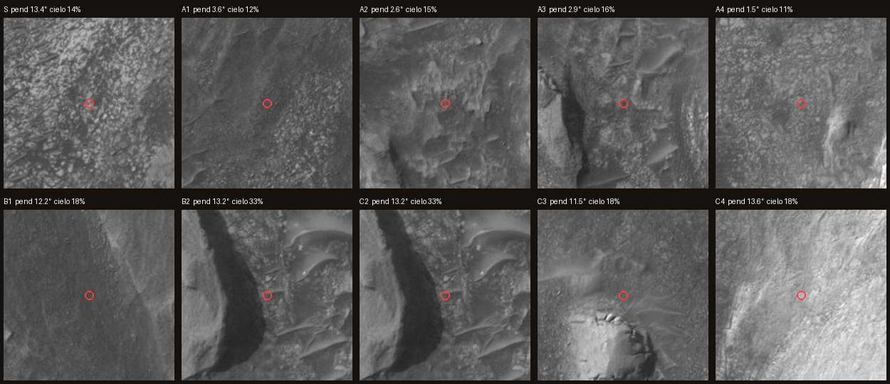

# Paradas desde el sol 5070: por qué, para qué y quién va

Cada parada se ubicó **sobre el terreno real** (DEM USGS de 2 m y ortofoto HiRISE de 0,5 m, `data/terreno/sol5070/`): para el vehículo, la celda más llana y menos rugosa cerca del borrador; para el astronauta, una celda caminable al pie de un afloramiento y con más cielo tapado. Las rutas se calcularon con A* y **no tienen tramos sobre 20°**. Datos: `data/rutas/rutas_sol5070_calculadas.geojson`.

## Rutas calculadas

| Ruta | Largo | Subida | Pendiente máx. | Tiempo | Dosis |
|---|---|---|---|---|---|
| A · Robot Curiosity | 1669 m | 198 m | 19.4° | 28–56 (30–60 m por sol) | — |
| B · Astronauta a pie, ida y vuelta | 2605 m | 156 m | 19.9° | 84 min | 37.8 µSv |
| C · Rover presurizado tripulado (mismo trazado que A; supuesto: ~10 km/h, concepto SEV) | 1669 m | — m | —° | 10 min | — |
| C · Caminata 1 (A2 → C2 → A2) | 962 m | 51 m | 19.6° | 30 min | 13.3 µSv |
| C · Caminata 2 (A3 → C3 → A3) | 808 m | 14 m | 19.7° | 20 min | 9.1 µSv |
| C · Caminata 3 (A4 → C4 → A4) | 759 m | 13 m | 19.6° | 19 min | 8.4 µSv |

## Hacia dónde nos acerca la ruta
- Todas las rutas **suben ~190 m** por el Monte Sharp, hacia capas más jóvenes. Desde órbita, el Monte Sharp muestra arcillas abajo, sulfatos encima y, en lo más alto, capas parecidas al polvo y sin minerales hidratados: la transición registraría cómo se secó Marte (Milliken y colaboradores, mapeo CRISM; Sheppard et al. 2021, JGR Planets, doi:10.1029/2020JE006372).
- El destino es el borde del terreno claro que creemos que es la **capa de yardangs**, próxima campaña de la misión (blog sols 4913–4919; panorámica del sol 4982). **A confirmar**.

## Fichas

### Salida: Curiosity, sol 5070 (campaña Nazca)
- **Quién va:** ambos
- **Por qué y para qué:** Punto de partida real. Acá terminó la campaña del pozo 49, Nazca, abierto en un bloque con muchos 'discos' que podrían ser cristales. La misión retoma desde acá el rumbo al sur.
- **Datos medidos en el terreno:** elevación -3473.9 m (+0.0 m sobre la salida), pendiente media en 10 m 13.4°, cielo tapado 14%, a 71 m de un afloramiento empinado. Coordenadas -4.82567°, 137.38915° E.
- **Fuente:** Blog de Curiosity, sols 5050–5055 y 5063–5069 (science.nasa.gov); posición: mapa 'Where is Curiosity?' de NASA

### A1 · Parada de recarga en terreno llano
- **Quién va:** rover
- **Por qué y para qué:** Superficie llana (3,6° de pendiente media) y poco rugosa sobre las bandas de arena y roca de Valle Grande. Sirve para estacionar, recargar baterías y documentar el contacto entre bandas sin arriesgar ruedas.
- **Datos medidos en el terreno:** elevación -3409.8 m (+64.1 m sobre la salida), pendiente media en 10 m 3.6°, cielo tapado 12%, a 66 m de un afloramiento empinado. Coordenadas -4.82989°, 137.39290° E.
- **Fuente:** Blog sols 5010–5015 (bandas de 25 a 200 m); 5056–5062 (soles de recarga); NASA sobre desgaste de ruedas

### A2 · Base frente a la loma (estéreo de capas)
- **Quién va:** rover
- **Por qué y para qué:** Llano (2,6°) a 24 m de un afloramiento. Desde acá el rover hace imágenes estéreo y de largo alcance de la loma para seguir las capas, como hace el equipo con los buttes Texoli, Cordillera y Mishe Mokwa. En la ruta C es el punto de bajada de la primera caminata.
- **Datos medidos en el terreno:** elevación -3348.1 m (+125.8 m sobre la salida), pendiente media en 10 m 2.6°, cielo tapado 15%, a 24 m de un afloramiento empinado. Coordenadas -4.83478°, 137.39654° E.
- **Fuente:** Informe SOWG sols 4566–4567 (estéreo de Texoli por un posible horizonte erosivo); blog sols 5050–5055 (imágenes remotas de Mishe Mokwa y Cordillera)

### A3 · Paso entre dunas y un butte claro
- **Quién va:** rover
- **Por qué y para qué:** Llano (2,9°) pero con ondulaciones de arena al lado. El rover cruza despacio, porque el equipo maneja esquivando arena para reducir el patinaje. Es la base de la segunda caminata, hacia el butte claro.
- **Datos medidos en el terreno:** elevación -3302.3 m (+171.5 m sobre la salida), pendiente media en 10 m 2.9°, cielo tapado 16%, a 22 m de un afloramiento empinado. Coordenadas -4.84004°, 137.39971° E.
- **Fuente:** Blog sols 4818–4824 (manejar esquivando arena y pendientes); foto HiRISE del recorte

### A4 · Llegada al borde del terreno claro (¿yardangs?)
- **Quién va:** rover
- **Por qué y para qué:** El punto más llano de la ruta (1,5°), a +193 m de la salida. Llega al terreno claro y estriado que creemos que es la capa de yardangs, el próximo gran destino de la misión: la capa con la que termina la sucesión del Monte Sharp en esta ladera. Una teoría es que sea ceniza volcánica.
- **Datos medidos en el terreno:** elevación -3281.4 m (+192.5 m sobre la salida), pendiente media en 10 m 1.5°, cielo tapado 11%, a 14 m de un afloramiento empinado. Coordenadas -4.84345°, 137.40528° E.
- **Fuente:** Blog sols 4913–4919 (unidad de yardangs como próxima parada); panorámica Mastcam del sol 4982 (NASA). Identificación de ESTE terreno como yardangs: a confirmar

### B1 · Primera loma: capas a mano
- **Quién va:** astronauta
- **Por qué y para qué:** A 6 m de un afloramiento empinado, en una pendiente caminable (12°). Una persona puede mirar las capas de cerca y buscar discos como los de Nazca, algo que al rover le costaría días de maniobra.
- **Datos medidos en el terreno:** elevación -3395.4 m (+78.5 m sobre la salida), pendiente media en 10 m 12.2°, cielo tapado 18%, a 6 m de un afloramiento empinado. Coordenadas -4.82837°, 137.39540° E.
- **Fuente:** Blog sols 5016–5021 (discos: ¿cristales o fragmentos de una capa dura?)

### B2 · Pie de la pared este de la loma (sombra de radiación)
- **Quién va:** astronauta
- **Por qué y para qué:** Es el lugar con más cielo tapado de la zona (33%), al pie de una pared. Junto a la pared hay bloques caídos de capas altas, que se pueden muestrear sin escalar. Por la sombra, la dosis bajaría quizás un 8% (extrapolación: lo medido es 4–5% con el 19% del cielo tapado). Junto a la roca sube la radiación reflejada.
- **Datos medidos en el terreno:** elevación -3333.2 m (+140.7 m sobre la salida), pendiente media en 10 m 13.2°, cielo tapado 33%, a 6 m de un afloramiento empinado. Coordenadas -4.83377°, 137.40113° E.
- **Fuente:** Ehresmann et al. 2021 (JGR Planets); Guo et al. 2021 (GRL); DLR 2026; cálculo propio de cielo tapado sobre el DEM USGS

### C2 · Caminata 1 desde el rover: pie de la loma
- **Quién va:** astronauta (desde rover tripulado)
- **Por qué y para qué:** El mismo lugar que B2, pero llegando desde el rover estacionado en A2. Es una caminata de 30 minutos ida y vuelta, en lugar de una salida de casi una hora y media desde la salida.
- **Datos medidos en el terreno:** elevación -3333.2 m (+140.7 m sobre la salida), pendiente media en 10 m 13.2°, cielo tapado 33%, a 6 m de un afloramiento empinado. Coordenadas -4.83377°, 137.40113° E.
- **Fuente:** Ver B2; ficha del Space Exploration Vehicle (NASA): el alcance depende de cuán rápido se vuelve a un ambiente presurizado

### C3 · Caminata 2: butte aislado
- **Quién va:** astronauta (desde rover tripulado)
- **Por qué y para qué:** Al pie de un pequeño butte claro y aislado. Un butte así suele ser el resto de una capa más dura que resistió la erosión. Se compara su roca con la de los discos y con la capa cementada. Es una hipótesis a probar.
- **Datos medidos en el terreno:** elevación -3303.0 m (+170.8 m sobre la salida), pendiente media en 10 m 11.5°, cielo tapado 18%, a 6 m de un afloramiento empinado. Coordenadas -4.83738°, 137.40542° E.
- **Fuente:** Hipótesis propia sobre la foto HiRISE; contexto: blog sols 4968–4974 (superficie erosiva)

### C4 · Caminata 3: contacto con el terreno claro
- **Quién va:** astronauta (desde rover tripulado)
- **Por qué y para qué:** Tocar y muestrear el contacto con el terreno claro: si es la capa de yardangs, sería la primera muestra de la capa nueva, que el rover tardaría semanas en alcanzar. La composición permite probar la idea de que es ceniza volcánica.
- **Datos medidos en el terreno:** elevación -3283.0 m (+190.8 m sobre la salida), pendiente media en 10 m 13.6°, cielo tapado 18%, a 6 m de un afloramiento empinado. Coordenadas -4.84041°, 137.41044° E.
- **Fuente:** Panorámica del sol 4982 y su texto (NASA); blog sols 4913–4919. A confirmar que este terreno sea esa capa

## Sobre la imagen THEMIS de Gale (falso color)
- Es útil como **contexto regional**, no para elegir paradas: THEMIS IR tiene unos **100 m por píxel**, así que toda nuestra zona (1,6 × 1,7 km) ocupa unos 16 × 17 píxeles y cada parada cae dentro de un píxel (NASA/JPL/ASU, PIA06814).
- Los colores marcan **diferencias de composición o temperatura**, no "minerales a excavar": en ese procesamiento el rosa-magenta suele ser arena basáltica (más el polvo), el verde-amarillo polvo y suelo, y el cian nubes de hielo de agua (PIA06814). El anillo rosa brillante es la arena basáltica que rodea al Monte Sharp.
- Para minerales a escala de ruta, la herramienta correcta es **CRISM** (espectrómetro de MRO, decenas de metros por píxel), que en el Monte Sharp detecta arcillas Fe/Mg, sulfatos mono y polihidratados y óxidos de hierro (Rice et al. 2015; Sheppard et al. 2021). Pendiente: buscar escenas CRISM sobre nuestra zona.
- **Mosaicos CRISM 2012 (Seelos et al., GMWG):** 8 productos en GeoTIFF + .tfw, 19,3 m/píxel, misma proyección que nuestro terreno (equirectangular, R=3396190), así que se superponen sin reproyectar. Los que sirven para justificar paradas son **HYD** (sulfatos: polihidratados magenta/azul, monohidratados verde/amarillo), **ALT** (arcillas Fe/Mg rojo/magenta, sulfatos hidratados verde/azul verdoso) y **FM2** (óxidos de hierro; verde/amarillo = hematita). Son indicadores **cualitativos y relativos**: hay costuras entre imágenes, ruido y desfasajes; identificar el mineral exige el espectro. Se armaron para la elipse de aterrizaje y la base del Monte Sharp (8 observaciones, entre ellas FRT0000B6F1 y HRL0000BABA); **falta confirmar si llegan a lat −4,82 a −4,85, lon 137,385 a 137,412**. Si no llegan, buscar observaciones CRISM dirigidas más nuevas (MTRDR) en el PDS ODE con ese recuadro.

## Limitaciones
- Pendientes a 2 m: el DEM promedia; una roca de 1 m no aparece.
- Los límites (20° para ambos, velocidad de marcha, factor de blindaje) son **provisorios** (`data/parametros.json`).
- La dosis con 33% de cielo tapado es una **extrapolación**: lo medido por RAD es 4–5% menos con 19% de cielo tapado.
- Las rutas del astronauta rodean pendientes: por eso las caminatas de la ruta C (300–385 m en línea recta) miden 760–960 m ida y vuelta.
